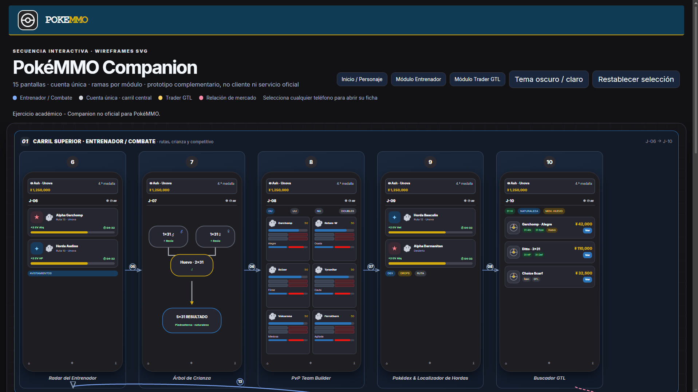

# Práctica 06 – Diagrama de Secuencia de Pantallas (Sketches) de PokéMMO Companion

Diagrama interactivo de **secuencia de pantallas (wireframes/sketches)** para una aplicación móvil *companion* de **PokéMMO**. El diagrama presenta una arquitectura de navegación basada en **3 carriles** que cubren una cuenta única con **2 módulos funcionales**: Entrenador/Combate y Trader del GTL. Todo el proyecto fue generado en un único archivo HTML autocontenido con renderizado SVG e interactividad CSS/JS.

**[👉 Ver el diagrama interactivo en GitHub Pages](https://elmau0834x.github.io/Practicas_Integradora_220859/Practica06/pokemmo-secuencia-pantallas.html)**

### Vista Previa del Diagrama

*(Nota: Reemplaza la ruta de la imagen con tu captura de pantalla real del proyecto final)*

---

### Nota Académica
Este trabajo es un ejercicio académico para la materia de Desarrollo Móvil Integral. Los bocetos de baja fidelidad y la interfaz **no son pantallas oficiales** del juego PokéMMO. El logotipo es de creación propia (SVG) inspirado en la estética pixel art de los monstruos de bolsillo. El proyecto no tiene afiliación con las marcas registradas de Nintendo o Game Freak; únicamente adapta mecánicas públicas del juego (Crianza, GTL, PvP) para fines de diseño de experiencia de usuario (UX).

---

## Concepto: PokéMMO Companion App

PokéMMO es un MMORPG que carece de herramientas oficiales fuera del juego para gestionar la economía y el competitivo. Esta aplicación móvil resuelve esa necesidad organizando el flujo en **3 carriles horizontales**:

1. **Carril Central (Tronco Común):** Pantallas globales de inicio de sesión, sincronización de personaje y un dashboard unificado.
2. **Carril Superior (Módulo Entrenador):** Herramientas para el juego diario como el radar de hordas, simulador de árbol de crianza (1x31 a 5x31) y constructor de equipos PvP.
3. **Carril Inferior (Módulo Trader GTL):** Desbloqueado tras obtener la 3.ª medalla en el juego. Herramientas financieras para calcular impuestos del 5% en el mercado, márgenes de *flippeo* y publicar lotes.

---

## Evolución de los Prompts (Generación con IA)

El desarrollo del diagrama se realizó mediante iteraciones progresivas utilizando Codex, estructurando el diseño desde la arquitectura base hasta el pulido visual de los componentes *gamer*:

| Versión | Objetivo del Prompt | Ajustes y Mejoras Posteriores |
|---|---|---|
| **v1** | Generar la estructura base HTML/CSS con 15 pantallas divididas en 3 carriles (Central, Superior e Inferior) con flechas de conexión. | Los textos se truncaban por límite de caracteres y había errores de codificación (mojibake). Se corrigió forzando UTF-8. |
| **v2** | Aplicar la paleta de colores nativa de PokéMMO (Azul cobalto, rojo Pokéball, dorado GTL) y dibujar el logotipo pixel art en SVG. | Las pantallas tenían un aspecto achatado tipo *smartwatch*. |
| **v3** | Configurar proporciones reales de smartphone (220x440px), numeración exterior, etiquetas y navegación interactiva (*smooth scroll* y *drawer*). | El interior de los wireframes parecía un formulario genérico de oficina. |
| **v4 (Hotfix)** | Reemplazar los inputs genéricos por **componentes de videojuegos**: cuadrículas de 6 slots para PvP, árboles de crianza con nodos, tarjetas de catálogo GTL con símbolo ¥ y tags de IVs. | Versión final. Diseño 100% fiel a las mecánicas de PokéMMO. |

---

🔍 Ver detalles técnicos de la implementación interactiva

*   **HTML/CSS Autocontenido:** No se utilizaron librerías externas. Todo el renderizado de *wireframes* se hizo con CSS Shapes y SVG *inline*.
*   **Navegación Smooth Scroll:** Botones superiores que anclan y enfocan dinámicamente cada uno de los 3 carriles.
*   **Drawer Lateral:** Al hacer clic en cualquier marco de teléfono, se despliega un panel lateral derecho que explica la función nativa de la pantalla dentro de las mecánicas de PokéMMO y su conexión en el flujo de usuario.
*   **Accesibilidad:** Soporte nativo para alternar tema oscuro/claro y manejo del atributo `prefers-reduced-motion` para desactivar las animaciones de desplazamiento.

---

## Arquitectura de Pantallas (15 Nodos)

**🌐 Carril Central (Globales):**
*   `S-01`: Splash Screen & Sync
*   `S-02`: Onboarding (Guía de herramientas)
*   `S-03`: Login & Selección de Personaje
*   `S-04`: Dashboard Central (Conmutador de módulos y Pokéyenes)
*   `S-05`: Perfil, Medallero y Ajustes

**⚔️ Carril Superior (Entrenador):**
*   `J-06`: Radar de Hordas y Alphas
*   `J-07`: Árbol de Crianza (Simulador de IVs y Recios)
*   `J-08`: PvP Team Builder (6 Slots, EVs y Movimientos)
*   `J-09`: Pokédex & Rutas de Farmeo
*   `J-10`: Buscador GTL (Filtro por IVs exactos y Naturaleza)

**💰 Carril Inferior (Trader GTL):**
*   `T-11`: GTL Hub Financiero (Balance y ventas)
*   `T-12`: Publicador GTL (Cálculo de impuestos)
*   `T-13`: Gestor de Flippeo (Tracker de márgenes de ganancia)
*   `T-14`: Panel de Clan / Gremio
*   `T-15`: Tendencias de Mercado (Gráficas de vanidades)

---

## Autor

**Mauricio Rosales Gabriel**  
Ingeniería en Gestión y Desarrollo de Software  
Universidad Tecnológica de Xicotepec de Juárez (UTXJ)  
[@elmau0834x](https://github.com/elmau0834x)